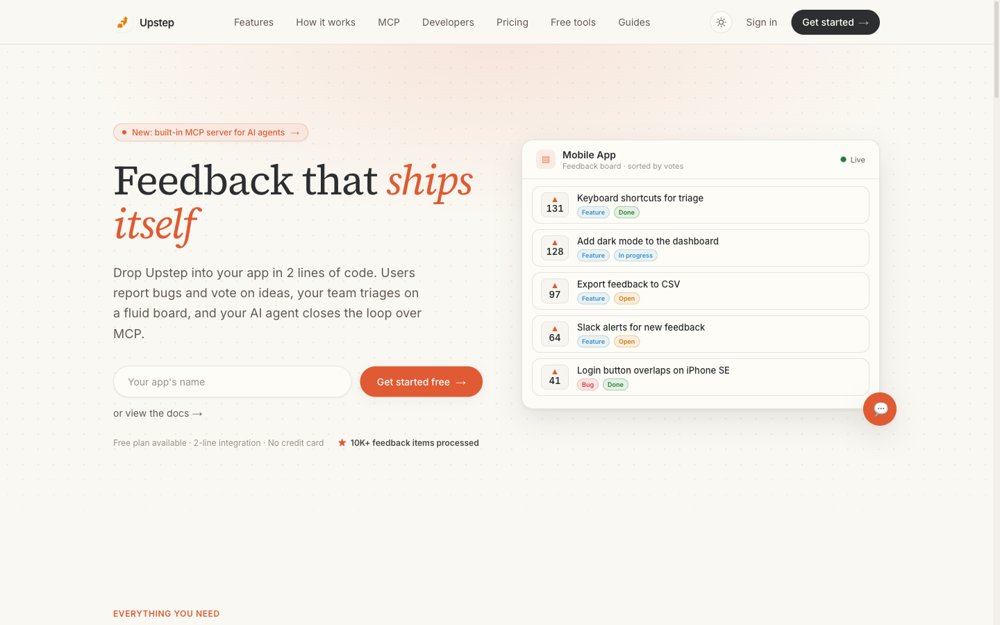
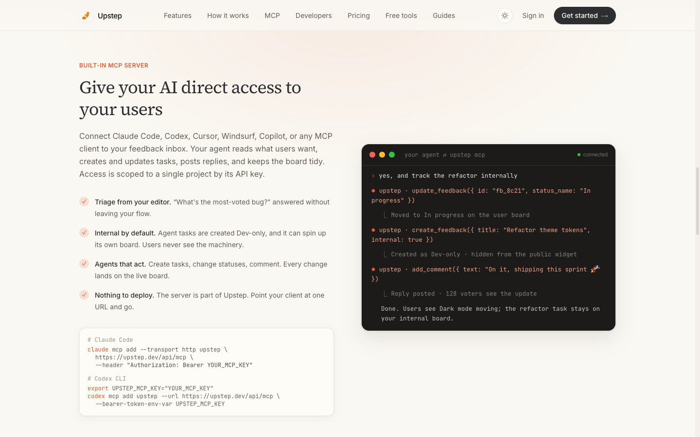
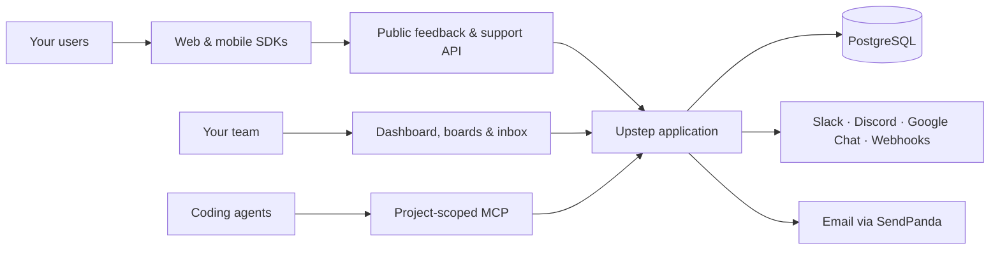
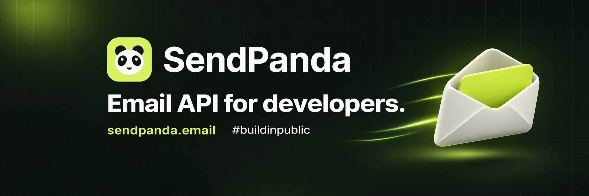

<p align="center">
  <a href="https://upstep.dev">
    
  </a>
</p>

<h1 align="center">Upstep</h1>

<p align="center">
  <strong>Feedback that ships itself.</strong><br />
  Collect feedback and support conversations inside your product, triage them on one board,<br />
  and give your coding agent a direct line to what users want.
</p>

<p align="center">
  <a href="https://upstep.dev"><strong>Try Upstep</strong></a>
  &nbsp;·&nbsp;
  <a href="DOCUMENTATION.md"><strong>Docs</strong></a>
  &nbsp;·&nbsp;
  <a href="#self-host-in-two-minutes"><strong>Self-host</strong></a>
  &nbsp;·&nbsp;
  <a href="ROADMAP.md"><strong>Roadmap</strong></a>
  &nbsp;·&nbsp;
  <a href="CONTRIBUTING.md"><strong>Contribute</strong></a>
</p>

<p align="center">
  
  
  
  
  
  <a href="https://sendpanda.email"></a>
</p>

<p align="center">
  
</p>

## Why Upstep

Most feedback tools stop at a list of ideas. Upstep closes the loop: the widget
your users see, the support inbox your team answers from, the board you triage
on, the roadmap you publish, and the MCP tools your agent works through, all in
one app you can run yourself.

| | |
| --- | --- |
| 💬 **In-product feedback** | A native widget for web, React, React Native and Flutter. Users never leave your app. |
| ▲ **Voting that ranks the backlog** | Identified and anonymous votes, deduplicated, so the most-wanted work rises to the top. |
| 🗂 **One board for triage** | Custom boards, statuses, labels, assignees, moderation, and private dev-only tasks. |
| 🎧 **Support that becomes work** | AI answers from your docs, a shared team inbox, live handoff, and conversations that turn into tasks. |
| 🤖 **Agents that can act** | Claude Code, Codex, Cursor, Windsurf, Copilot or any MCP client can read, create, update and comment on tasks. |
| 🗺 **A public roadmap** | Share what's planned and shipped while internal tasks stay private. |
| 🔔 **Your team's tools** | Slack, Discord, Google Chat threads per task, webhooks, and email via [SendPanda](https://sendpanda.email). |
| 🏠 **Self-hosted by default** | One Next.js app and PostgreSQL. No Redis, no extra workers to babysit. |

## Built for humans and agents

The MCP server is part of the app, not a sidecar. A private, project-scoped key
lets an agent triage feedback from your editor, while publishable SDK keys stay
safe to embed in client apps.

<p align="center">
  
</p>

```bash
# Claude Code
claude mcp add --transport http upstep https://upstep.dev/api/mcp \
  --header "Authorization: Bearer YOUR_MCP_KEY"

# Codex CLI
export UPSTEP_MCP_KEY="YOUR_MCP_KEY"
codex mcp add upstep --url https://upstep.dev/api/mcp \
  --bearer-token-env-var UPSTEP_MCP_KEY
```

## Add the widget

```bash
npm install @upstep/js
```

```tsx
import { FeedbackWidget, UpstepProvider } from "@upstep/js/react";

export function App() {
  return (
    <UpstepProvider apiKey="upstep_pk_your_publishable_key">
      <YourProduct />
      <FeedbackWidget />
    </UpstepProvider>
  );
}
```

Also available for vanilla JavaScript, a script tag, React Native and Flutter.
See the [SDK guide](DOCUMENTATION.md#sdks).

## How it fits together



Rate limits and notification retries are durable and backed by PostgreSQL, so
one deployable app is the whole system.

## Self-host in two minutes

You need Docker with Compose and a GitHub or Google OAuth app.

```bash
git clone https://github.com/TheBugEater/upstep.git
cd upstep
cp apps/web/.env.example apps/web/.env
docker compose up --build
```

Add your database URL, auth secret and OAuth credentials to `apps/web/.env`,
then open [http://localhost:3000](http://localhost:3000). For GitHub OAuth, use
this callback URL:

```text
http://localhost:3000/api/auth/callback/github
```

Compose starts PostgreSQL, applies the committed Prisma migrations, starts
Upstep and processes notification retries. Containers expose `GET /api/health`
and respect the platform's `PORT`.

### Email (optional)

Feedback notifications and team invitations are sent through
[SendPanda](https://sendpanda.email), a developer-first email API. Create a
send-only key, verify your sending domain, and set:

```bash
SENDPANDA_API_KEY=your-send-only-key
SENDPANDA_FROM_EMAIL="Upstep <hello@your-domain.com>"
```

Without a key, Upstep runs normally and skips email. Template IDs and the full
setup are in the [email documentation](DOCUMENTATION.md).

### Local development

```bash
corepack enable
pnpm install
cp apps/web/.env.example apps/web/.env
docker compose up -d postgres
pnpm --filter @upstep/web exec prisma migrate deploy
pnpm dev
```

```bash
pnpm test
pnpm type-check
pnpm build
```

## Keys are intentionally separate

| Credential | Where it belongs | Access |
| --- | --- | --- |
| `upstep_pk_…` | Browser and mobile SDKs | Publishable; limited to the public feedback API |
| `upstep_mcp_…` | Secret stores and MCP clients | Private; scoped to one user and project, following current membership and role |

Personal MCP keys are shown once and stored only as SHA-256 digests. Each
teammate manages their own key; see [personal MCP access](docs/mcp-personal-access.md).
Never treat a publishable SDK key as protection for private data, and read the
[security policy](SECURITY.md) before exposing a production instance.

## Repository map

```text
apps/web/                    Next.js dashboard, API, MCP and marketing site
packages/sdk-web/            @upstep/js
packages/sdk-react-native/   @upstep/react-native
packages/sdk-flutter/        upstep_flutter
packages/types/              @upstep/types
```

| Resource | What you will find |
| --- | --- |
| [Documentation](DOCUMENTATION.md) | Setup, environment variables, SDKs, REST API, data model, billing, dashboard behavior |
| [Roadmap](ROADMAP.md) | What's planned next |
| [Changelog](CHANGELOG.md) | What shipped |
| [Contributing](CONTRIBUTING.md) | Development workflow, migrations, tests, pull requests |
| [Security](SECURITY.md) | Vulnerability reporting and credential model |
| [Code of Conduct](CODE_OF_CONDUCT.md) | Community expectations |
| [Licensing](LICENSING.md) | AGPL server and MIT SDK boundaries |
| [Trademark policy](TRADEMARKS.md) | Rules for the Upstep name and logo |

## Deployment

`railway.toml` configures the hosted deployment, but any platform that runs a
Node.js container and PostgreSQL works. Run `prisma migrate deploy` before each
release, call `POST /api/internal/notifications` every minute with
`Authorization: Bearer $CRON_SECRET`, and test database restores regularly.

Self-hosted instances send no Upstep product analytics while
`NEXT_PUBLIC_ONRAMP_API_KEY` is blank, which is the default.

## Email by SendPanda

<p align="center">
  <a href="https://sendpanda.email">
    
  </a>
</p>

<p align="center">
  Upstep sends its email with <strong><a href="https://sendpanda.email">SendPanda</a></strong>,
  an email API for developers with templates, verified domains and a REST API.<br />
  <a href="https://sendpanda.email"><strong>sendpanda.email →</strong></a>
</p>

## License

The server is licensed under [AGPL-3.0-only](LICENSE). Independently
distributed SDK and shared-type packages are MIT. The Upstep name and logos
are covered by the [trademark policy](TRADEMARKS.md).

<p align="center">
  Built in public for builders who would rather ship than manage another feedback tool.
</p>
